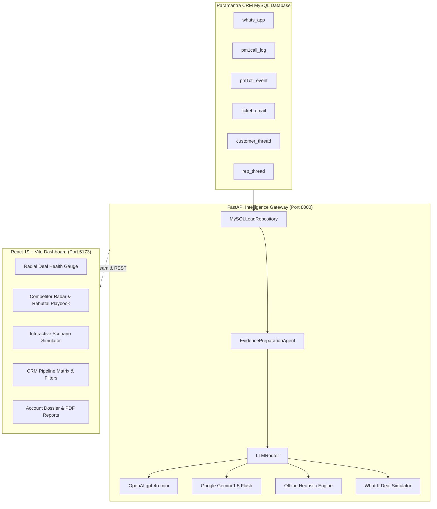

# Paramantra SalesBattle

> **Omnichannel Semantic Intelligence & Real-Time Deal Health Predictor** for B2B CRM Sales Teams.

SalesBattle transforms scattered CRM communications—WhatsApp chats, call logs, CTI telephony events, support tickets, rep notes, and email exchanges—into an actionable, predictive **Sales Battlecard**.

---

## 🚀 Key Highlights & Capabilities

- **Multi-Provider AI Engine & Fallback Router**:
  - **OpenAI** (`gpt-4o-mini`) with structured JSON outputs.
  - **Google Gemini** (`gemini-1.5-flash`) REST structured outputs.
  - **Deterministic Heuristic Engine**: 100% offline, air-gapped demo mode that performs semantic analysis without cloud API costs or key expirations.
  - **Adaptive Failover**: Automatically switches providers upon rate limit (429) or authentication errors (401).

- **Real-Time Streaming Intelligence**:
  - Live **Server-Sent Events (SSE)** streaming (`/api/leads/{id}/sync-stream`) emitting multi-step progress: Extraction (25%), Preparation (50%), AI Scoring (75%), and Complete (100%).

- **Quantitative Deal Health & Emotional Diagnostics**:
  - 0.0 to 10.0 Deal Health Score with 4-pillar decomposition (Customer Sentiment, Engagement Frequency, Intent Urgency, Risk Penalty).
  - Multi-dimensional emotional gauges: Trust & Rapport, Commercial Urgency, and Negotiation Stance.
  - Channel Sentiment Pulse across WhatsApp, Email, Calls, CTI, and Customer Threads.

- **Competitor Radar & Interactive Objection Playbook**:
  - Automatic detection of competitors (Salesforce, Zoho, HubSpot, Freshsales, Dynamics, LeadSquared, etc.).
  - Quoted objection evidence with 3 tactical rebuttal angles (Value/ROI, Technical Architecture, Delivery/SLA).
  - 1-Click Push to CRM thread to log structured rep action plans.

- **Phase 3 Advanced Semantic Intelligence**:
  - **Temporal Momentum & Velocity ($dS/dt$)**: Half-life decay recency weighting and stall/ghosting risk detection.
  - **Multi-Stakeholder Consensus Mapping**: Distinguishes Champions, Economic Buyers, and Technical Evaluators.
  - **Interactive "What-If" Deal Scenario Simulator**: Simulates score changes and generated pitch scripts when offering concessions (discounts, SLA commitments, setup fee waivers).

---

## 🏗️ Architecture



---

## ⚡ Quick Start

### Prerequisites
- **Python 3.11+**
- **Node.js 18+** & **npm**
- **MySQL 8.0+**

### 1. One-Click Start (Windows PowerShell)
```powershell
.\Start-SalesBattle.ps1
```
This script validates your environment, starts the FastAPI backend on port 8000, and launches the Vite frontend on port 5173.

---

### 2. Manual Setup

#### Backend Setup
```bash
cd backend
python -m venv venv

# Windows
.\venv\Scripts\activate
# Linux/macOS
source venv/bin/activate

pip install -r requirements.txt
cp .env.example .env
# Configure DB_NAME, DB_USER, DB_PASSWORD, and optional OPENAI_API_KEY / GEMINI_API_KEY in .env

# Seed sample CRM pipeline leads
python scripts/seed_pipeline_leads.py

# Start FastAPI server
uvicorn app.main:app --host 127.0.0.1 --port 8000 --reload
```

#### Frontend Setup
```bash
cd frontend
npm install
npm run dev
```

Visit **`http://localhost:5173`** in your browser.

---

## 📡 API Endpoints Reference

| Method | Endpoint | Description |
| :--- | :--- | :--- |
| `GET` | `/api/health` | Health check verifying database connection & active AI provider status |
| `GET` | `/api/leads` | List CRM leads with pipeline stages, status, and assigned reps |
| `GET` | `/api/leads/{id}/timeline` | Retrieve chronological omnichannel conversation timeline |
| `GET` | `/api/leads/{id}/battlecard` | Fetch cached or generated deal health battlecard |
| `POST` | `/api/leads/{id}/sync` | Trigger fresh semantic analysis and save battlecard cache |
| `GET` | `/api/leads/{id}/sync-stream` | Real-time Server-Sent Events (SSE) streaming analysis progress |
| `POST` | `/api/leads/{id}/actions` | Push rep action plans and rebuttal scripts into CRM `rep_thread` |
| `POST` | `/api/leads/{id}/simulate` | Simulate deal health impact for hypothetical commercial concessions |
| `PATCH`| `/api/leads/{id}` | Update CRM lead contact, company, status, or stage |

---

## 🧪 Testing & Code Quality

### Backend Unit Tests
```bash
cd backend
.\venv\Scripts\python.exe -m unittest discover -s tests -v
```

### Frontend Tests & Linting
```bash
cd frontend
npm test          # Runs 11+ Node test suite
npm run lint      # Runs Oxlint
npm run build     # Production Vite build
```

---

## 📄 License
Internal proprietary software developed for Paramantra CRM.
